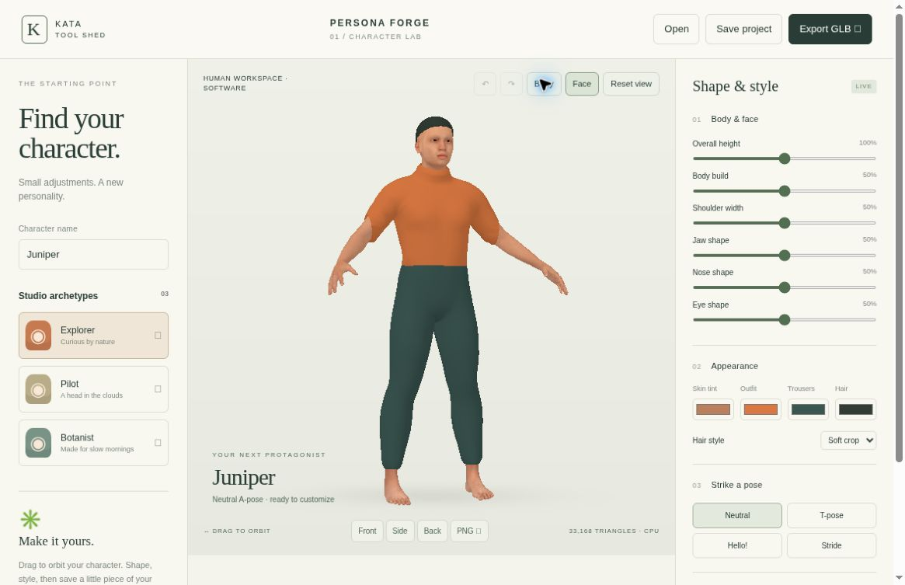

# Kata Persona Forge

**A character, from the inside out.** A local-first human character workshop inspired by character-creation workflows. This **version 2 human foundation** replaces the procedural mannequin with a licensed MakeHuman/MPFB anatomical adult.

This revision is local and has not been published. The existing public GitHub Pages app remains the earlier revision until deployment is authorized.



## Run

Node.js 18 or newer. The renderer and human assets are bundled locally; no npm install or runtime CDN request is required.

```sh
npm run dev
# http://127.0.0.1:4186
npm run check
npm run build
```

Always run an HTTP server and visit localhost. Never open a `file://` URL. Production files go into `dist/`; serve that directory over HTTP. Use `PORT=4300 npm run dev` to change the port.

## Human foundation

- One coherent anatomical adult with a UV-mapped 2048px skin texture and 1024px eye texture.
- A weighted 53-bone skeleton. Neutral, T-pose, Hello and Stride are bone-driven static poses, not walking animation.
- Five paired morph controls: body build, shoulders, jaw, nose and eyes. Ten editable shape keys are retained. Overall height scales the whole character from 90–110%.
- Separate fitted top, trousers and a simple solid cropped scalp, with no-hair option. No simulated cloth or strand hair.
- Three modest preset variations; they share the same base human.
- Body/face inspection, front/side/back views and drag/keyboard orbit.
- Forty-edit undo/redo, best-effort browser autosave, editable `.persona` projects and PNG snapshots.
- **GLB export** retains the current shape, color, height, selected pose, UV textures, skin weights, bones and pose clips. Hidden hair is omitted. Open and edit it in Blender.

The normal renderer is locally bundled Three.js 0.180.0 with WebGL 2. Where WebGL is unavailable, the labeled **software preview** rasterizes the same textured, morphed, skinned human, with reduced lighting and resolution. Export remains the full asset. If neither WebGL nor Canvas 2D can be created, the app reports the problem and leaves project saving/editing available. It never substitutes a different mannequin.

## Existing projects

Version 1 projects migrate explicitly to version 2. The original validated parameters are retained as `legacySource` in the downloaded project, and the old `kata-persona-v1` autosave key is not overwritten. The new key is `kata-persona-v2`.

Migration is **approximate**: old height/shoulder ranges are clamped/mapped to the smaller controls; unsupported proportions remain in `legacySource`; rounded bob maps to crop. The original geometry is not preserved. The UI displays this limitation. Future project versions, invalid fields, out-of-range values and files over 100 KB are rejected.

## Privacy and accessibility

No backend, login, telemetry, uploads or external runtime asset requests. Autosave is origin-specific and is not a durable document library. Download projects as backups. Storage failures are reported.

Controls are labeled, keyboard focus is visible, selection states are exposed and status messages are announced. Focus the preview and use Left/Right to orbit. Ctrl/Cmd+S saves, Ctrl/Cmd+Z undoes, and Ctrl/Cmd+Shift+Z redoes outside editable fields. On narrow screens the preview comes first and all editing controls remain available. This visual modeling tool is not a complete nonvisual 3D editor.

## Verify and rebuild

- `npm run check`: syntax checks and Node regression tests, including project migration, GLB structure, skinning/morph references, software rendering and HTTP serving. Legacy procedural tests are retained separately as regression history; they do not validate the new anatomy.
- `/tests/browser-foundation.html`: actual local app loading, migration, undo/redo, focus, pose and narrow layout checks.
- `/tests/roundtrip.html`: actual renderer GLB export checks and downloadable customized test asset.
- `/tests/unsupported.html`: explicit unavailable-canvas error path.
- `/tests/asset-review.html`: genuine Blender reference renders served over HTTP.
- `tools/rebuild-human.sh`: rebuild the source asset from pinned official upstream sources with Blender 4.3+ and git. This downloads build dependencies only.
- `blender -b --python tools/validate-human.py -- input.glb report.json`: import the GLB and test editable bones/shape keys.

The retained packed source is `assets/source/foundation.blend`. Runtime assets are in `assets/human/`. The Blender source and build dependencies are not copied into `dist/`. See [verified QA and limits](docs/QA-FOUNDATION.md).

## Scope and licenses

This is a small human foundation, **not Character Creator 5 parity or a photorealistic production character system**. There is no demographic library, facial animation, facial rig, rig editing UI, external mesh import, clothing simulation, subdivision editing or texture authoring. Skin tint is a multiplicative tint, not a new skin scan. Extreme combinations need collision/rig-fit review. Bare feet and the solid scalp are intentional prototype limits.

Application code is MIT. Three.js is MIT. Human assets are CC0 1.0, with individually verified source/material headers, pinned references and retained evidence in [asset provenance](docs/ASSET-LICENSES.md). MakeHuman/MPFB source code is GPLv3 and is used only as an external build-time dependency; it is not bundled into the browser app. The retained/exported human assets have their own CC0 grant.

Inspired by [Character Creator 5](https://www.reallusion.com/character-creator/) by Reallusion. No affiliation, endorsement, proprietary assets or file-format compatibility.
