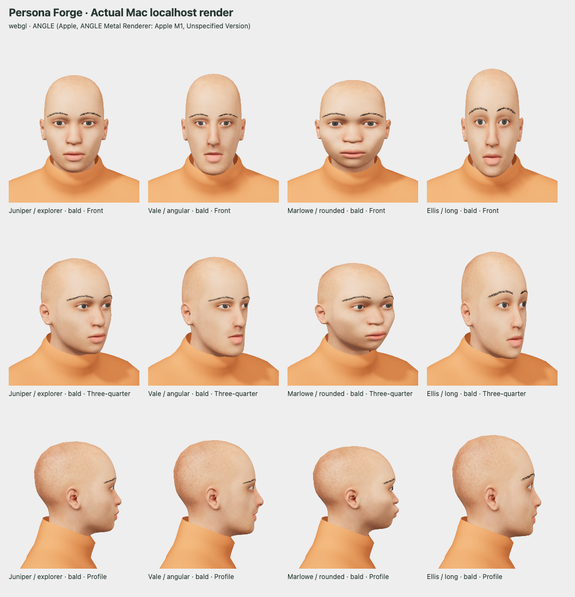
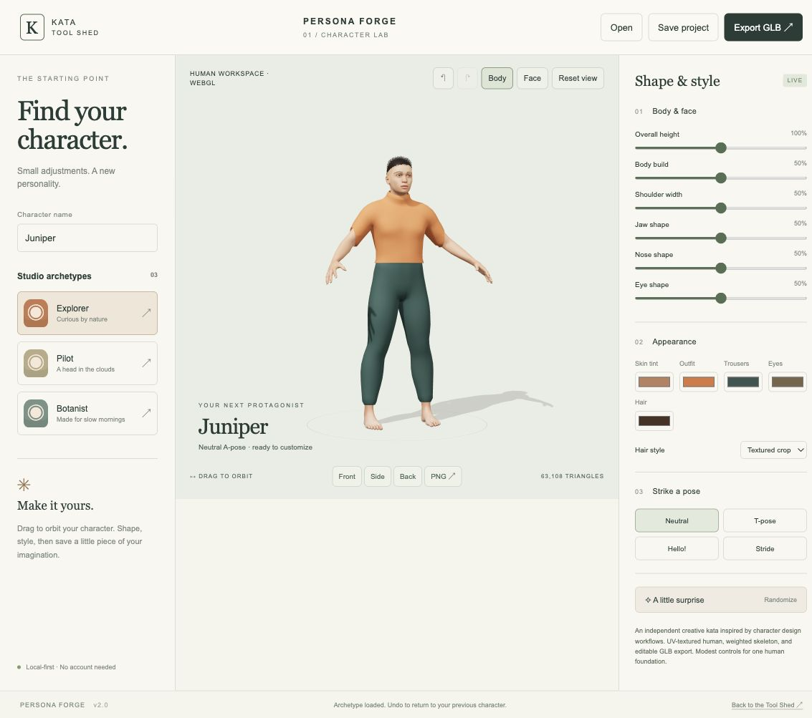
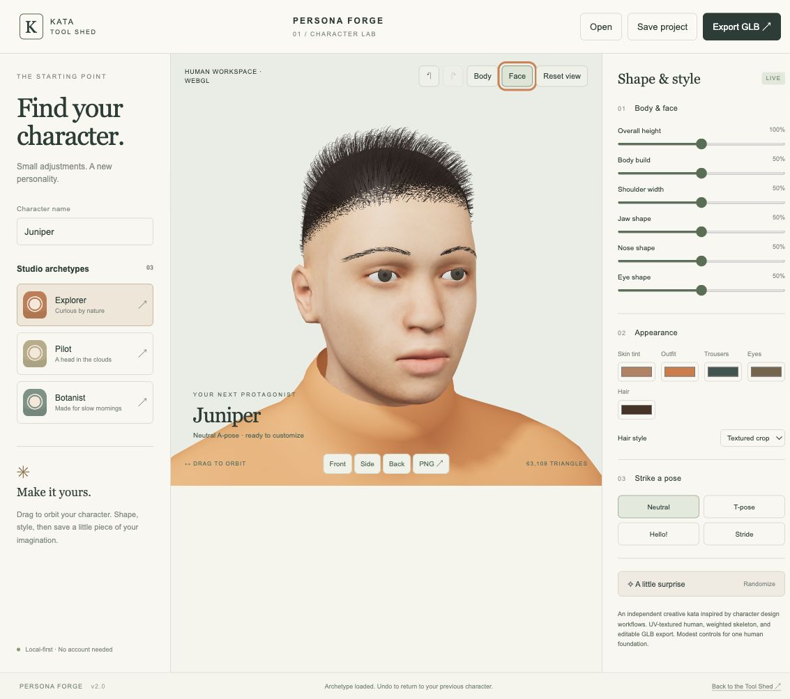
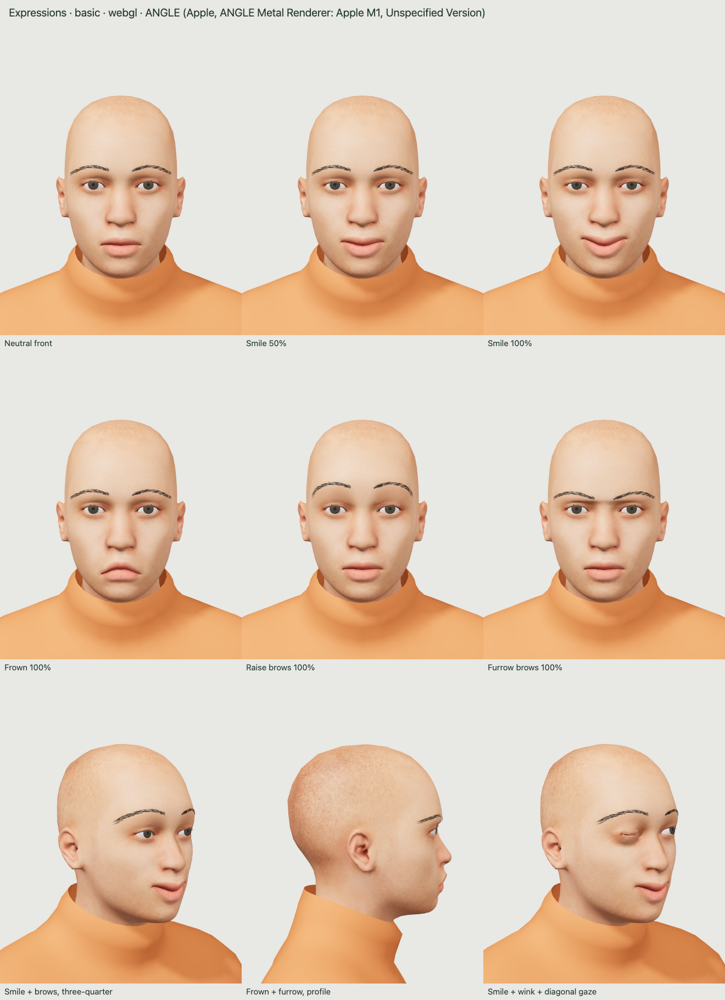
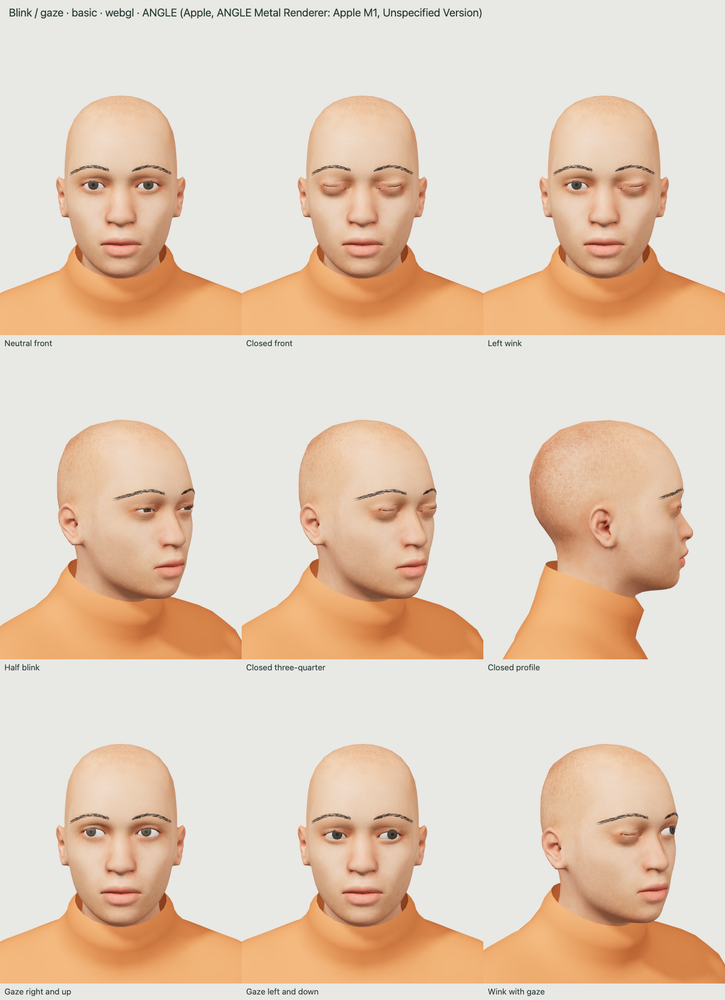
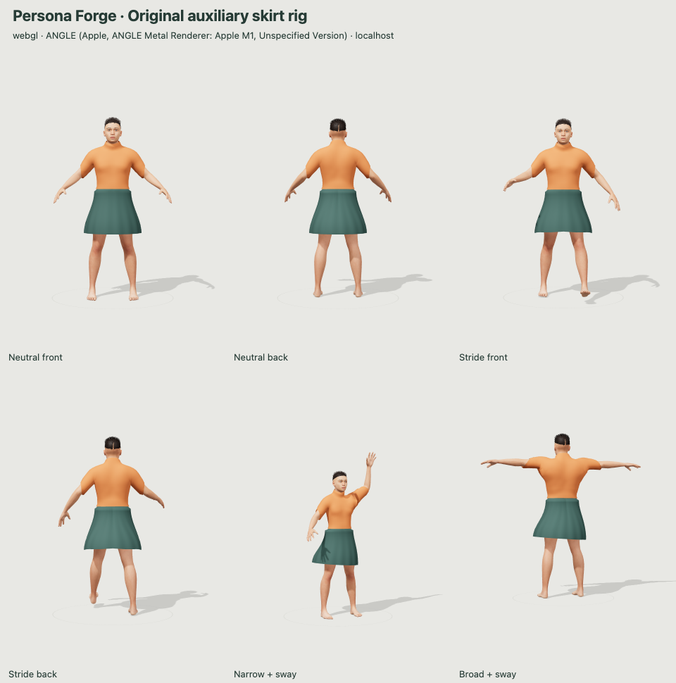

# Kata Persona Forge

**A character, from the inside out.** A local-first human character workshop inspired by character-creation workflows. This **version 2 human foundation** replaces the procedural mannequin with a licensed MakeHuman/MPFB anatomical adult.

[Open Persona Forge](https://intrepion.github.io/kata-app-inspired-by-character-creator-5-codex-dot/). The human foundation was first published from commit `e4bcb71`. The distinct-faces milestone was published from `d5e31df`; it adds nine facial controls and three adult presets while preserving the portrait and waist/pose work. See [distinct-faces verification and limits](docs/QA-DISTINCT-FACES.md).







## Expression prototype

The **Expressions** panel adds adjustable Smile, Frown, Raise brows and Furrow brows, a neutral reset, undo/redo and saved-project compatibility. Smile lifts the cheeks and adds a slight eye squeeze while manual blink and gaze remain adjustable. GLB exports retain editable named expression targets. These are closed-mouth expressions; jaw controls, mouth interior and speech are a later milestone. See [expression verification and limits](docs/QA-EXPRESSIONS.md).



## Blink-and-gaze prototype

This prototype adds independent left/right blinks and bounded horizontal/vertical gaze in a new **Eyes** panel. Neutral eyes reset, undo/redo, project save/open and editable GLB targets are included. Older projects remain neutral. The earlier eye-only milestone is retained by the expression prototype above. See [verification, Blender editing and limits](docs/QA-BLINK-GAZE.md).



## Original skirt-rig milestone

This release adds an original optional A-line skirt with nine garment-only auxiliary bones, editable fit morphs and a Hem sway control. The original 53-bone human, distinct faces and earlier garment fixes are preserved. Choose **A-line skirt** in Appearance → Outfit, then try Stride or Hem sway. This is bone posing, not cloth simulation. Existing projects still open with trousers. See [construction, verification and limits](docs/QA-SKIRT.md).



## Run

Node.js 18 or newer. The renderer and human assets are bundled locally; no npm install or runtime CDN request is required.

```sh
npm run dev
# http://127.0.0.1:4186
npm run check
npm run build
```

Always run an HTTP server and visit localhost. Never open a `file://` URL. Production files go into `dist/`; serve that directory over HTTP. Use `PORT=4300 npm run dev` to change the port.

## Human foundation

- One coherent anatomical adult with a UV-mapped 2048px skin texture and 1024px eye texture.
- Original pore-normal and roughness maps, neutral studio lighting and reflected eye highlights.
- A weighted 53-bone skeleton. Neutral, T-pose, Hello and Stride are bone-driven static poses, not walking animation.
- Fourteen paired morph controls: body build, shoulders, jaw, nose, eyes, head width/height, cheeks, chin, nose width/projection, eye spacing, brow height and lips. Twenty-eight appearance shape keys and three pose correctives stay editable. Overall height scales the whole character from 90–110%.
- Separate fitted top, a choice of trousers or an original A-line skirt, and a textured short crop with tapered ribbon fibers, with no-hair option. Brows/lashes follow face morphs. No simulated cloth or groom simulation.
- Separate iris color keeps the sclera neutral; skin and hair colors remain tints.
- Original Explorer/Juniper, Pilot/Orion and Botanist/Fern preserved, plus three adult face presets: Angular/Vale, Rounded/Marlowe and Long/Ellis. The new presets use identical styling so their geometry differences are visible. All share one anatomical foundation.
- Body/face inspection, front/side/back views and drag/keyboard orbit.
- Forty-edit undo/redo, best-effort browser autosave, editable `.persona` projects and PNG snapshots.
- **GLB export** retains the current shape, color, height, selected pose, UV textures, skin weights, bones and pose clips. Hidden hair and the unselected lower garment are omitted. Skirt export includes its nine auxiliary bones; trousers retain only the original body rig. Open and edit it in Blender.

The normal renderer is locally bundled Three.js 0.180.0 with WebGL 2. Where WebGL is unavailable, the labeled **software preview** rasterizes the same textured, morphed, skinned human, with reduced lighting and resolution. Export remains the full asset. If neither WebGL nor Canvas 2D can be created, the app reports the problem and leaves project saving/editing available. It never substitutes a different mannequin.

## Existing projects

Existing version 2 files without `eyeColor` load with the neutral iris default. Omitted new facial controls load at their unchanged neutral value of 0.5. Omitted garment fields default to trousers and neutral sway. Omitted blink/gaze fields default to zero (open eyes and straight gaze). Omitted expression fields also default to zero (neutral). Invalid supplied values remain errors. New saves retain every face control; older app builds reject these new fields. The version 1 legacy payload is unchanged.

Version 1 projects migrate explicitly to version 2. The original validated parameters are retained as `legacySource` in the downloaded project, and the old `kata-persona-v1` autosave key is not overwritten. The new key is `kata-persona-v2`.

Migration is **approximate**: old height/shoulder ranges are clamped/mapped to the smaller controls; unsupported proportions remain in `legacySource`; rounded bob maps to crop. The original geometry is not preserved. The UI displays this limitation. Future project versions, invalid fields, out-of-range values and files over 100 KB are rejected.

## Privacy and accessibility

No backend, login, telemetry, uploads or external runtime asset requests. Autosave is origin-specific and is not a durable document library. Download projects as backups. Storage failures are reported.

Controls are labeled, keyboard focus is visible, selection states are exposed and status messages are announced. Focus the preview and use Left/Right to orbit. Ctrl/Cmd+S saves, Ctrl/Cmd+Z undoes, and Ctrl/Cmd+Shift+Z redoes outside editable fields. On narrow screens the preview comes first and all editing controls remain available. This visual modeling tool is not a complete nonvisual 3D editor.

## Verify and rebuild

- `npm run check`: syntax checks and Node regression tests, including project migration, GLB structure, skinning/morph references, software rendering and HTTP serving. Legacy procedural tests are retained separately as regression history; they do not validate the new anatomy.
- `/tests/browser-foundation.html`: actual local app loading, migration, undo/redo, focus, pose and narrow layout checks.
- `/tests/waist.html`: close-up front/back/side garment review using authored GLB normals. See [waist repair evidence and limits](docs/QA-WAIST.md).
- `npm run test:garment-source`: source boundary/sleeve regression (Python 3 + NumPy, no Blender required).
- `/tests/deformation.html`: visible height/foot-anchor checks and front/back pose/build comparisons, with a separate corrective export check. Use `?software=1` to force the CPU preview when WebGL is unavailable.
- `/tests/distinct-faces.html`: matched bald front/profile/three-quarter comparisons, crop and combined extremes, timing/UI/export checks. `?software=1` tests the fallback.
- `/tests/portrait.html`: front, three-quarter, profile, bald and extreme face/material comparisons, with renderer/GPU reporting.
- `/tests/expressions.html?auto&capture`: expression comparisons; add `&mode=presets`, `&mode=extremes` or `&software=1`. Capture requires the server’s `--qa-exports` option.
- `/tests/expression-controls.html?capture`: controls, reset/undo, project compatibility and narrow-layout checks.
- `/tests/roundtrip.html`: actual renderer GLB export checks and downloadable customized test asset.
- `/tests/unsupported.html`: explicit unavailable-canvas error path.
- `/tests/asset-review.html`: genuine Blender reference renders served over HTTP.
- `tools/rebuild-human.sh`: rebuild the source asset from pinned official upstream sources with Blender 4.3+ and git. This downloads build dependencies only.
- `blender -b --python tools/validate-human.py -- input.glb report.json`: import the GLB and test editable bones/shape keys.

`tools/distinct-faces.py` adds the original face layer after the portrait build. `tools/validate-distinct-faces.py` compares all 18 new editable targets across the eight fitted face meshes after Blender reimport.

The retained packed source is `assets/source/foundation.blend`. Runtime assets are in `assets/human/`. The Blender source and build dependencies are not copied into `dist/`. See [verified QA and limits](docs/QA-FOUNDATION.md) and [local deformation-fix QA](docs/QA-DEFORMATION.md).

## Scope and licenses

This is a small human foundation, **not Character Creator 5 parity or a photorealistic production character system**. The expression prototype adds closed-mouth expression posing alongside blink/gaze. There is no demographic library, mouth interior, jaw control, lip-sync, facial animation timeline, rig editing UI, external mesh import, clothing simulation, subdivision editing or texture authoring. Skin tint is a multiplicative tint, not a new skin scan. Pose corrections preserve joint volume and exported weights, but remain an approximation at extreme appearance combinations; see [pose deformation](docs/POSE-DEFORMATION.md). Extreme combinations still need collision/rig-fit review. Bare feet and the stylized procedural crop are prototype limits. The crop adds original texture, tapered fibers and a faded edge, but is not a scanned or production strand-groom hairstyle.

Application code is MIT. Three.js is MIT. The original procedural portrait additions are MIT. The retained foundation human assets are CC0 1.0, with individually verified source/material headers, pinned references and retained evidence in [asset provenance](docs/ASSET-LICENSES.md). MakeHuman/MPFB source code is GPLv3 and is used only as an external build-time dependency; it is not bundled into the browser app. The retained/exported human assets have their own CC0 grant.

Inspired by [Character Creator 5](https://www.reallusion.com/character-creator/) by Reallusion. No affiliation, endorsement, proprietary assets or file-format compatibility.
