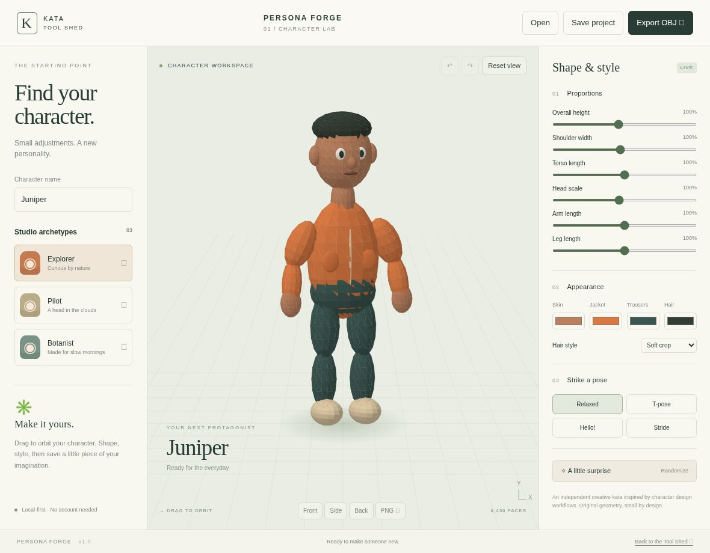
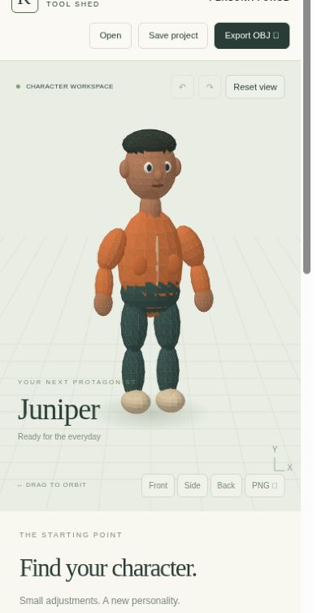

# Kata Persona Forge

**A character, from the inside out.** An original, local-first character design kata inspired by the adjustable proportions, appearance and posing workflows of Character Creator 5.

Part of [Kata Tool Shed](https://intrepion.github.io/tools/). Repository: `kata-app-inspired-by-character-creator-5-codex-dot`.

## Screenshots

Genuine browser captures of the running HTTP app, not mockups.



<details><summary>390-pixel narrow layout</summary>



</details>

## Run

Node.js 18 or newer. No dependencies to install and no runtime network requests.

```sh
npm run dev
# Open http://127.0.0.1:4186
npm run check
npm run build
```

Use `PORT=4300 npm run dev` to choose another port. In PowerShell: `$env:PORT=4300; npm run dev`. Always use the running HTTP server, never a `file://` URL. Static production files are copied to `dist/`; serve that directory over HTTP.

## Create a character

- Begin with Explorer, Pilot or Botanist, each made from original procedural geometry.
- Adjust height, shoulders, torso, head, arms and legs. Appearance includes four color choices and three hairstyles.
- Choose Relaxed, T-pose, Hello or Stride. Drag the preview to orbit, or use Front, Side and Back.
- Undo and redo up to 40 character edits. Loading an archetype is also undoable.
- Save an editable `.persona` JSON project and reopen it later. Browser autosave is best-effort; a downloaded project is the durable backup.
- Export a real triangulated **OBJ** mesh with RGB vertex colors. Vertex-color support varies between 3D applications. The mesh uses independent triangles and contains no UV coordinates, skeleton, weights or animation.
- Download a **PNG** of the current character preview.

## Keyboard and accessibility

All form controls are labeled and have visible keyboard focus. Focus the preview and use Left/Right arrows to orbit. Ctrl/Cmd+S saves the project. Ctrl/Cmd+Z and Ctrl/Cmd+Shift+Z undo and redo when not editing a text/control field. Buttons expose selected states and the footer announces changes. This visual modeling tool does not provide a complete nonvisual geometry editing experience.

On narrow screens the interactive preview appears first, followed by presets and the complete editing panel. Mouse, touch and keyboard input are supported; physical pen hardware has not been tested.

## Scope

This is a small, functional **stylized character generator**, not a replacement for Character Creator 5. The 3D preview is a custom Canvas 2D triangle renderer with orbiting and directional lighting, not a WebGL engine. The model is composed from ellipsoids and capsule-like limb segments. Pose changes directly reposition geometry.

It does not support production rigging, facial animation, skinning, body scans, clothing simulation, skeletal animation, texture authoring, HD morphs, subdivision, anatomy-grade realism, external mesh import, or Reallusion file formats. Stride is a static pose, not a walking animation.

## Files, privacy and safety

There is no backend, sign-in, telemetry, upload or CDN asset dependency. Projects remain in the browser until explicitly downloaded. Autosave uses `kata-persona-v1` in origin-specific local storage; another hostname/port, private browsing, browser cleanup or storage quota can affect it. Storage errors are reported. Undo history is in memory and is not restored after a reload.

Project imports are limited to 100 KB and validate schema, parameter ranges, colors, style names and a 60-character character name. Imported strings are inserted as text. Opening a project asks before replacing unsaved edits and remains undoable. Local storage is not a document library.

## Verification

`npm run check` runs syntax checks and nine Node tests covering validation, geometry, morphs, history, OBJ output and HTTP serving. Open `/tests/browser.html` through the running server for interaction/export/import checks. These browser test harnesses are excluded from `dist/`. See [QA notes](docs/QA.md) for the actual browser verification and limits.

## Structure

- `src/model.js`: parameters, validation, history, procedural mesh and OBJ serializer.
- `src/app.js`: rendering, UI, input, persistence and file actions.
- `docs/INSPIRATION.md`: primary-source research and original implementation scope.
- `app.json`: Tool Shed metadata and source inspiration.

## License and attribution

MIT, see [LICENSE](LICENSE). Original code, design and procedural assets. [Character Creator 5](https://www.reallusion.com/character-creator/) is by Reallusion; this project has no affiliation, endorsement or file-format compatibility. No proprietary artwork, logos or code were copied. Combined Windows, macOS and Linux/Unix `.gitignore` also covers editor files, build outputs and local secrets.

This is an independent educational kata. See the QA notes for verification scope and limitations.


## Published app

Open [Kata Persona Forge](https://intrepion.github.io/kata-app-inspired-by-character-creator-5-codex-dot/). The public repository uses GitHub Actions to verify and deploy `dist/` from `main`. See [QA notes](docs/QA.md) for local verification and known limits.
