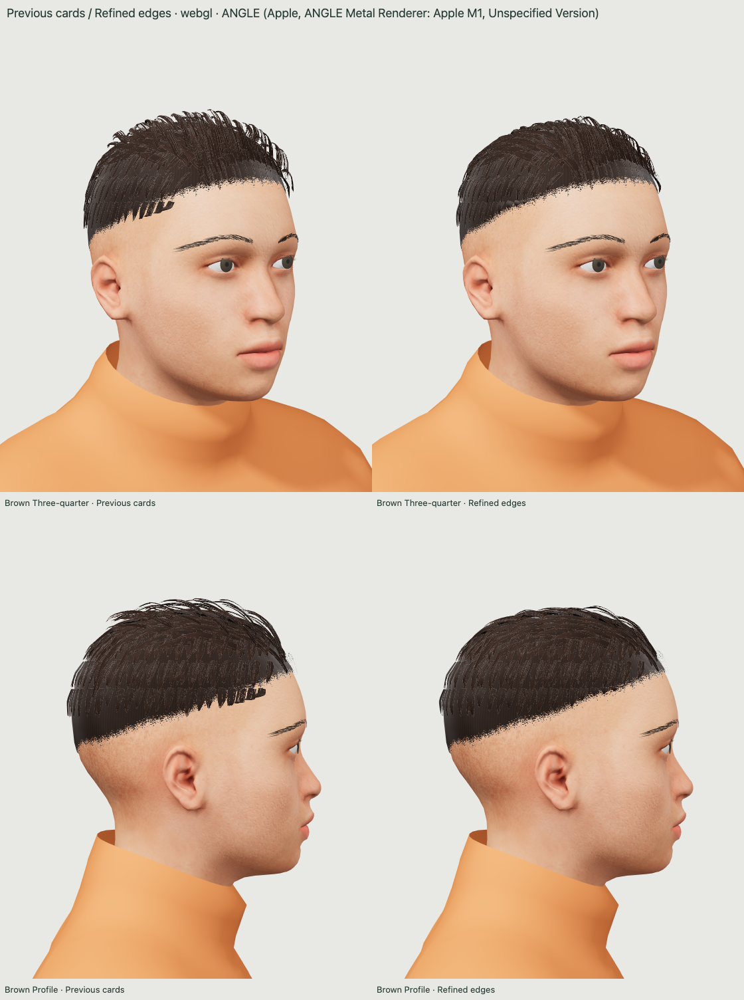
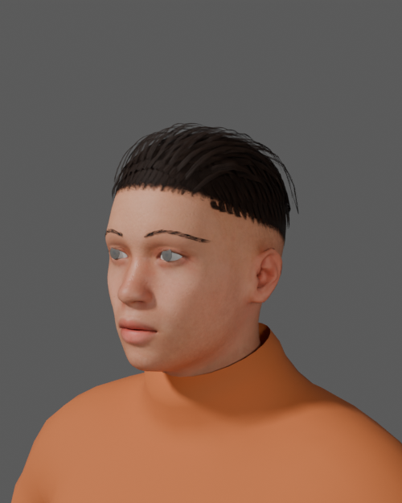
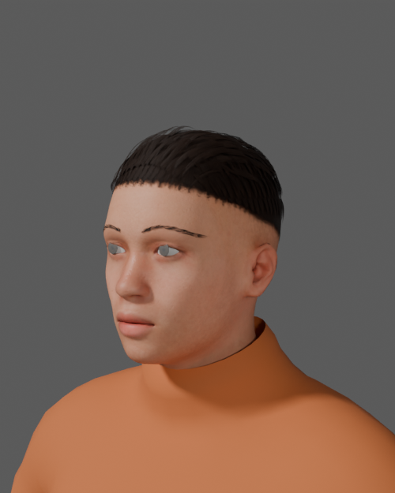

# Hair perimeter refinement

Local follow-up to the Blender-card experiment at `4fa5234`. The user liked that groom but reported weird parts at the edges. This pass is not published or approved for publication.

## Visual outcome

The prominent hooked teeth and broad squared ends above both temples are removed. The lower boundary follows the scalp more cleanly on neutral and extreme head shapes. Raised crown locks are tucked closer into the hair mass, reducing the open-loop/wire effect without removing the swept silhouette. Hair is slightly less tall, especially in front view.

The result is better, not finished production hair. A few thin crown arcs and stepped rear layers remain at close range. The dark backing and uniform lower edge can still read as a cap, while blond hair lacks natural color depth. Further broad lowering would make it too flat. No new scalp gaps or clipping were apparent in the reviewed matched views.



[Brown, blond and black front/three-quarter/profile comparison](screenshots/persona-hair-edges-comparison.png) · [Back, opposite side, extreme morphs and rim light](screenshots/persona-hair-edges-extremes.png)

These are actual localhost hardware WebGL captures, not illustrative renders. Each pair has the same camera, project values, tint and light. The baseline is the exact previous GLB, retained under `tests/fixtures/hair-cards-before-edges.glb` and guarded by its SHA-256. Neither comparison invokes the older procedural generator.

## Geometry and editability

- Guide paths stop inside the actual scalp boundary rather than projecting to a nearest boundary point and folding into hooks. Thirty-one guides are trimmed. Cards whose remaining length is too short are omitted.
- Width tapers near the scalp boundary. Tip lift settles to the surface instead of retaining a floating layer offset. The curved card cross-section now narrows with its local width, fixing a raised central ridge at thin tips; the manual curve-rebake utility uses the same correction.
- Outer swept locks and silhouette wisps are restrained. Central crown lift is reduced, more behind than at the front, preserving the haircut's direction and front volume.
- The original strand and scalp maps, tint, PBR materials and runtime shading are unchanged. This is a mesh refinement, not a browser-only trick.
- The compressed `assets/human/hair-cards/original-short-groom.blend` retains 435 editable guide curves, baked mesh cards and packed textures. The app GLB contains the same two skinned meshes, `HairGroom` and `HairCardRoot`, each with 28 identity targets. The original foundation and body rig are unchanged.

The card-tip check measures a maximum scalp distance of 0.675 mm against a 1.5 mm limit. A deliberately floated tip fails the test. This rest-shape clearance check does not establish perfect strand collisions at every pose. A real 6 mm guide-control edit and rebake moves the mesh by about 5.20 mm and retains 28 identity keys, without saving over the authored source. The manual edit/rebake workflow from [the previous report](QA-HAIR-CARDS.md#method-and-editable-source) still applies.

## Browser, export and Blender verification

- 30 matched hardware views pass on Mac Chrome, ANGLE Metal / Apple M1: three hair colors; front, three-quarter and profile; back/opposite side; head/body endpoints; all identity maxima; and blond rim lighting. Repeated crop/bald/crop works. No console or shader errors.
- The forced CPU fallback completes the same 30 views and visibility checks. Its simplified shading is not equivalent to hardware anisotropy or normal mapping.
- 107 real application checks pass, including hair visibility, tint undo/redo, project save/open/reload, cancelled import, eye/expression controls and 390px layout. The QA autosave is restored.
- All 127 Node/syntax regression checks and the static build pass. The built application loads the refined asset in hardware WebGL and retains its enabled GLB export and Face view.
- Four actual browser exports cover previous cards, refined neutral, blond extreme head/expression/skirt/stride and bald/wave. Geometry, topology, UVs, weights, selected morph values, skeleton transforms, materials, textures, skin and all four pose clips are checked. Bald export contains no hair meshes.
- Blender 5.2.3 LTS imports the actual extreme export, edits hair/head/face controls, saves an editable `.blend`, reexports and reimports successfully. It preserves 53 body bones plus nine skirt bones and both 28-key hair meshes. All 15 deliberately corrupted controls are rejected and all 13 guarded source hashes remain unchanged. The focused Blender roundtrip excludes animation; all four pose clips are verified separately in the browser exports.
- Texture alpha and opaque RGB are exact; fractional-alpha atlas RGB has expected canvas rounding below one premultiplied 8-bit level. The normal map and regional skin maps remain exact. No claim of byte-identical image serialization is made.

Six Blender Cycles renders use the actual baseline and neutral browser exports with unchanged imported materials. These separate renders also show the temple overhang and raised loops reduced. Blender's own lights, shadows and AgX differ from the browser preview, so they are not pixel-matched to it.

Previous Blender export:



Refined Blender export:



Exact captures, hashes, checks, texture measurements and editability results are recorded in [HAIR-EDGES-VERIFICATION.json](HAIR-EDGES-VERIFICATION.json).

## Performance

The refined default character has 56,508 triangles versus 56,668 before, a reduction of 160 triangles. Cards alone have 14,355 vertices / 17,400 triangles; the cap adds 258 vertices / 428 triangles. The new GLB is 9,337,076 bytes versus 9,382,676 bytes before. Texture resolution, material count and runtime shader path are unchanged.

A 24-sample synchronized draw test measured medians of 1.7 ms refined versus 1.6 ms before and 95th percentiles of 3.9 ms versus 2.4 ms. These CPU-submission-plus-`gl.finish()` samples are noisy and are not interactive FPS measurements. There is no demonstrated speed improvement. Sequential, cache-not-cleared asset load samples were about 374 ms refined versus 460 ms before, also not a cold-load benchmark. Mobile GPU performance has not been measured.

## Reproduce

```sh
node server.mjs --port 4198 --qa-exports
# Open /tests/hair-edges.html?auto&capture&exports
# Open /tests/hair-edges.html?auto&capture&software
# Open /tests/expression-controls.html?capture
/Applications/Blender.app/Contents/MacOS/Blender -b --python-exit-code 1 --python tools/validate-hair-edge-shape.py
/Applications/Blender.app/Contents/MacOS/Blender -b --python-exit-code 1 --python tools/validate-hair-card-editability.py
/Applications/Blender.app/Contents/MacOS/Blender -b --python-exit-code 1 --python tools/validate-hair-edges-export.py
/Applications/Blender.app/Contents/MacOS/Blender -b --python-exit-code 1 --python tools/render-hair-edges-export.py
npm run check
npm run build
```

Capture endpoints remain opt-in, loopback-only, same-origin, size-bounded and restricted to exact filenames. The previous-card fixture and Blender source are excluded from the static build. No third-party assets, purchases, publication or ZIP delivery are included. Licensing is unchanged: original MIT groom over retained CC0 foundation.
