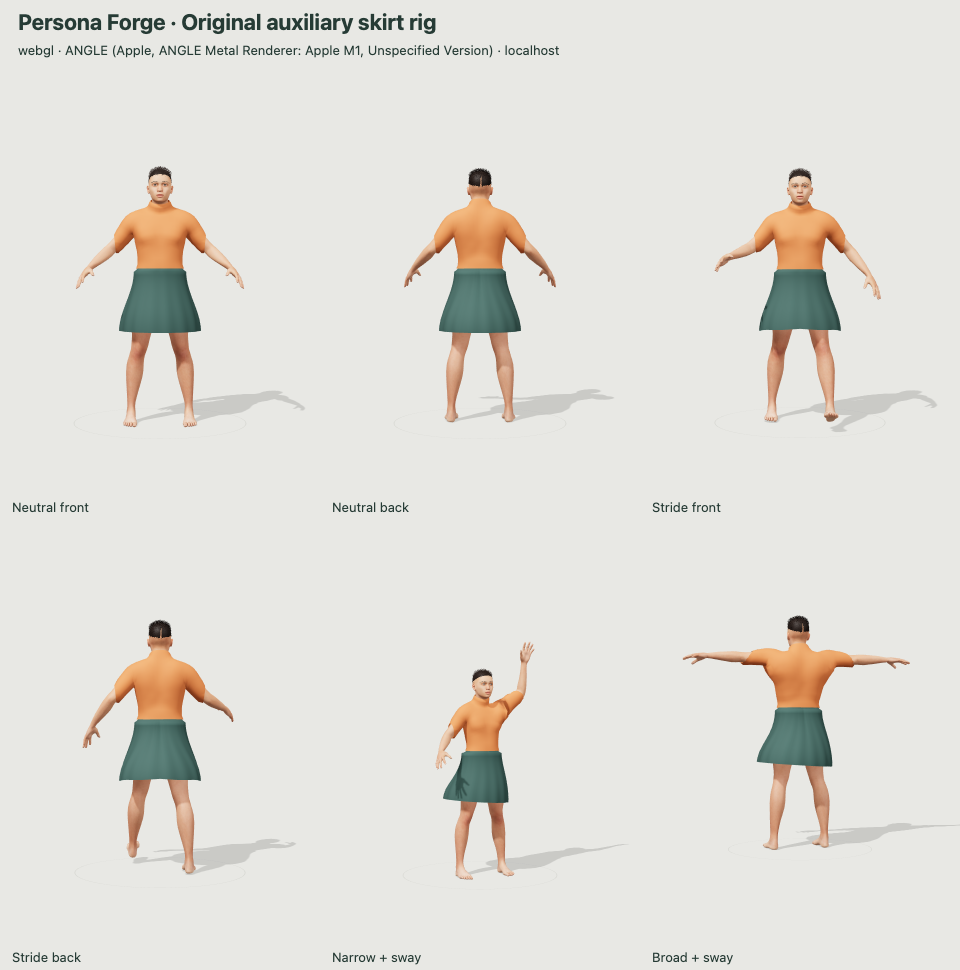

# Original auxiliary skirt rig: local milestone

This milestone is **not published**. It starts from the published distinct-face baseline `d5e31df0d2f030ab1d15534d981a72dabdd4a5dc` and adds a separately authored optional garment. No TailorRig dataset, model, source code, learned skin weights, demo assets, or restricted material is used.

## Try it

Run `node server.mjs --qa-exports --port 4194`, then visit `http://127.0.0.1:4194/`. Under Appearance, choose **A-line skirt** in Outfit. The existing Lower garment color tints either trousers or skirt. Hem sway poses the hanging panels by up to ±0.12 radians (about ±6.9°); it is not animation or cloth simulation.

- `/tests/skirt.html?auto=1&capture`: actual hardware/software renderer, structural and sampled fit checks, comparison capture. Use **Verify exports** for the three exact GLB captures.
- `/tests/skirt.html?auto=1&capture&software=1`: forced software preview comparison, using only the fixture canvases.
- `/tests/skirt-controls.html?capture`: app UI, save, import cancellation, undo/redo, repeated selection, reload and narrow-layout checks. It restores the prior QA autosave.
- `/tests/browser-foundation.html`: retained migration, posing and import regression harness.

All visual review uses HTTP localhost, never file URLs. The explicitly approved numerical tests and headless Blender reimport read the local generated exports; they do not open files in the GUI.

## Construction and compatibility

`src/skirt-rig.js` constructs original 96-segment, 15-row A-line topology with subtle fluting, UVs and normal morphs. It contains 1,455 UV-seam-split vertices and 2,688 triangles. The hidden waistband is fitted against the already-licensed trousers contour; the hanging shell has deliberate ease around the hips and stride. Its material is an original plain, rough surface, with no new texture dependency.

The existing 53-bone skeleton retains every original name, parent and rest/bind transform. A separate nine-bone skin uses `skirt_anchor` and eight `skirt_panel_XX` bones, attached beneath the original pelvis. Every skirt vertex is influenced only by those garment joints, with at most three positive influences and normalized weights. Body vertices keep their original weights. Narrow/broad fit morphs follow Body build; the four static pose clips retain the existing body tracks and include original auxiliary panel rotations. The sleeve, waist, face and portrait assets are unchanged.

The optional skirt and all nine auxiliary nodes are omitted when exporting trousers. Skirt export contains 62 total joints (53 body plus nine garment), omits trousers, and retains embedded textures, facial morphs, four static pose clips and the current shape/color/height. Hair omission remains supported. The returned triangle count now reflects visible meshes. Animation targets are resolved to UUIDs before applying the user’s name, so names such as `Skirt`, `HumanBody` or `skirt_panel_01` cannot redirect pose tracks.

Version-2 projects missing `lowerGarment` and/or `skirtSwing` gain `trousers` and/or `0`. Explicit invalid fields are rejected, and version-1 migration preserves its original `legacySource`. New fields are saved, undoable and retained through reload. Older app builds reject the additional fields; backward compatibility means old projects open in this new build, not that old builds understand the new garment. All six presets continue to use trousers and neutral sway. Randomize preserves the selected garment and sway.

## Verified evidence

- Final aggregate checks: `npm run check` passes 82 tests; `npm run build` succeeds; the retained Python waist/sleeve boundary regression passes using Blender’s installed Python.
- Browser test-first loop: the acceptance page first failed because the skirt module did not exist. A second failure exposed an overly high waistband contour; the first visual stride review exposed inward panel rotation. Both were corrected and the same harness rerun.
- Hardware renderer: WebGL 2, `ANGLE (Apple, ANGLE Metal Renderer: Apple M1, Unspecified Version)` in local Chrome.
- Visual review: neutral front/back, stride front/back, narrow build at 90% height with negative sway/Hello, broad build at 110% height with positive sway/T-pose. Software preview renders the same garment with reduced shading.
- Browser fit grid: four poses × five build values × three sway values = 60 combinations. 25,860 sampled radial lower-body surface comparisons across seven horizontal bands and 5° azimuth intervals. Minimum body clearance 14.40 mm; minimum sampled shirt-over-skirt clearance 9.33 mm. No missing sampled sections.
- Independent exported-fit evaluation: NumPy reads the actual exported morph buffers, pose channels, inverse bind matrices and weights. 120 cases include both shoulder extremes, with 69,000 samples and the same minimum clearances. A denser independent review scanned 36 cases every 5 mm vertically and 2° around the lower hem, finding no penetration in 381,987 valid comparisons (minimum clearance 12.20 mm); missing-ray cases are excluded from that extra scan, so it is not an exhaustive collision proof.
- UI harness: 37 checks, including repeated selection, both sway endpoints, shared color, old-project defaults, saving and parsing the actual project download, canceled/accepted import, history branching, preset/randomize behavior, reload and 375 px overflow.
- Independent exact-export verification: three captured files are matched to browser-recorded SHA-256 and byte size before examination. All original body geometry, UVs, normals, weights, morph buffers and pose channels are retained. Maximum original inverse-bind-matrix error is zero. Skirt maximum weight-sum error is `3.35e-8`.
- Headless Blender 5.2.3: reimported the captured skirt GLB; editing an auxiliary bone moved the skirt about 122.6 mm and the body exactly 0. Editing the forearm moved the body about 225.7 mm and the skirt exactly 0. Editing a head shape moved body/head vertices about 14.4 mm. A pristine imported editable rig is saved separately as `artifacts/skirt-editable.blend`, without overwriting either foundation source.

Machine-readable local evidence: `artifacts/skirt-report.json`, `skirt-software-report.json`, `skirt-controls-report.json`, `skirt-export-validation.json`; exact exports: `skirt-neutral.glb`, `skirt-stride.glb`, `skirt-trousers.glb`. These are generated test artifacts, not bundled in the deployed app. Run `python3 tools/validate-skirt-export.py --help` for structural validation and Blender instructions. `npm run check` includes synthetic rig/topology regressions, negative controls, and both original foundation file hashes.

## Limits

This is one original, open-edged, double-sided prototype shell, not a sewn or physically simulated garment. It has no collision solver, dynamics, wind, material thickness, automatic rigging or motion playback. The existing body exposes only four static poses; numerical fit sampling is not a proof for arbitrary custom Blender edits or every continuous parameter value. Hand/arm overlap and non-radial interpenetration are reviewed visually rather than covered by the lower-body radial test. Editing bones or shape keys beyond the app's supported limits in Blender can produce clipping. The default body source `.blend` remains the earlier human foundation; use the separate imported skirt `.blend` or export a chosen skirt character to edit the new garment.
